<p align="center">
  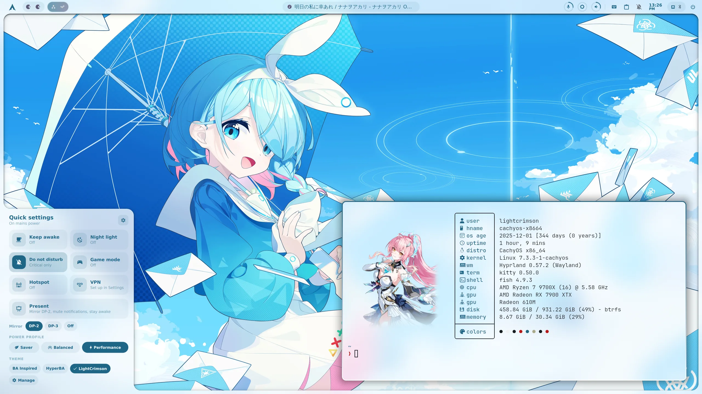
  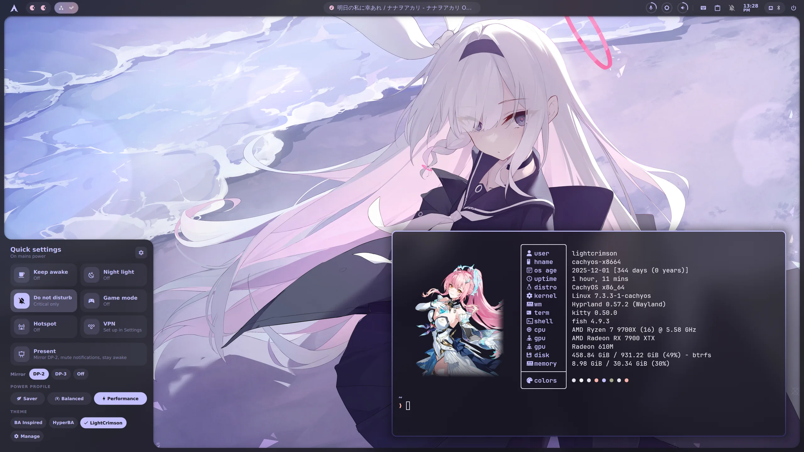
</p>

<h1 align="center"> ML4W LightCrimson Dotfiles </h1>

<p align="center">
  <a href="https://github.com/yurihikari/ml4w-lightcrimson-dotfiles/stargazers"></a>
  <a href="https://github.com/yurihikari/ml4w-lightcrimson-dotfiles/issues"></a>
  <a href="https://github.com/yurihikari/ml4w-lightcrimson-dotfiles/network/members"></a>
  <a href="https://github.com/yurihikari/ml4w-lightcrimson-dotfiles/blob/main/LICENSE"></a>
</p>

## About ❓
These dotfiles install the default profile of [ML4W](https://github.com/mylinuxforwork/dotfiles) and add my own desktop on top of it: a custom [Quickshell](https://quickshell.outfoxxed.me/) shell that replaces Waybar and SwayNC, a Settings app, image and video wallpapers (also per workspace), a capture drawer, and a theme switcher with extra themes.

Used on CachyOS, and should work on any Arch-based system.

## Features 👍

### 🐚 Quickshell desktop shell (replaces Waybar and SwayNC)
- **Screen frame and top bar**: workspaces with app icons, system tray, media pill, mic/brightness/volume rings (scroll to adjust), keyboard layout, notification bell, clock, and a network/Bluetooth/battery pill
- **Popups** that open on the monitor under your mouse:
  - **Media** (`META+M`): MPRIS player with album art, a Cava visualizer, player switching, audio output and volume
  - **Calendar** (`META+C`): month view with week numbers, weather (Open-Meteo) and a world clock
  - **System** (`META+N`): Wi-Fi, Bluetooth, and performance (CPU, every GPU with a dGPU/iGPU switch, memory, network, game mode, power profile)
  - **Dashboard** (`META+I`): system info, storage, updates and quick folders
  - **Dock** (`META+A`): app launcher with fuzzy search and keyboard navigation, notes and a to-do list
  - **Clipboard** (`META+SHIFT+V`): clipboard history with image and text previews; Clear empties every clipboard history
  - **Keyboard layout** (`META+SHIFT+K`), **Power** (`META+X`), **Radial menu** (`META+R`), **Display manager** (`META+ALT+M`)
- **Corner drawers**: quick settings in the bottom left (`META+ALT+Q`: keep awake, night light, Do Not Disturb, game mode, hotspot, VPN, presentation mode, power profile, theme) and capture in the bottom right (`PRINT`)
- **Notifications**: toasts with images, actions and inline replies, a notification center grouped by app, Do Not Disturb (critical notifications still show)
- **On-screen display** for volume, mic and brightness

### ⚙️ Settings app (`META+SHIFT+I`)
Wi-Fi, network and VPN, firewall, Bluetooth, displays, sound, power, appearance (light/dark mode, wallpapers), themes, keyboard, printers, system and Hyprland settings in one window.

### 🖼️ Wallpapers
- **Video wallpapers** (mp4, webm, mkv, mov, m4v), muted, looped and hardware-decoded. Colours, transitions and the blurred variants come from the video's first frame. Videos pause while windows cover them and stop in game mode.
- **Per-workspace wallpapers** (`META+SHIFT+E`): give each workspace its own image or video
- **Wallpaper selector** (`META+CTRL+W`), **carousel** (`META+W`) and Settings > Appearance list videos next to images, with a play badge
- Colours follow the wallpaper (matugen), in light or dark mode (`META+SHIFT+M`)
- **GTK and Qt apps too**: GTK 4 / libadwaita and GTK 3 apps (adw-gtk3), Qt apps (qt6ct) and KDE apps (Dolphin, Kate...) are drawn in the wallpaper's colours and switch between light and dark with the rest, without picking a theme. Running Qt apps take the new colours when restarted.

### 📸 Capture drawer (`PRINT`)
- Screenshots of a region, window, screen or every screen, with a delay and annotation; saved and copied to the clipboard (`SHIFT+PRINT`: region)
- Screen recording with system sound and microphone (`CTRL+PRINT` to start and stop), and instant replay (gpu-screen-recorder)
- Text from the screen (OCR) and a colour picker (`META+P`)

### 🎮 Game mode (`META+ALT+G`)
Turns off animations, blur and rounding, and stops video wallpapers until you turn it off.

### 🎭 Themes (`dotswitch`)
Switch between complete themes (bar, drawers, Hyprland config) while your data follows you: notes, wallpapers, monitor layout and default apps. See [Themes](#themes-) below and [dotswitch/README.md](dotswitch/README.md).

### 🐚 Shell
- zoxide for bash, fish and zsh (`cd` jumps to directories you've visited), plus aliases
- zsh plugin path fix for AUR vs git clone installs
- Fastfetch with a custom logo and GPU info

## Gallery 🖼️
<table>
  <tr>
    <td>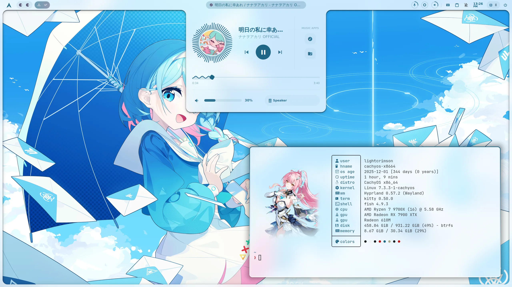</td>
    <td>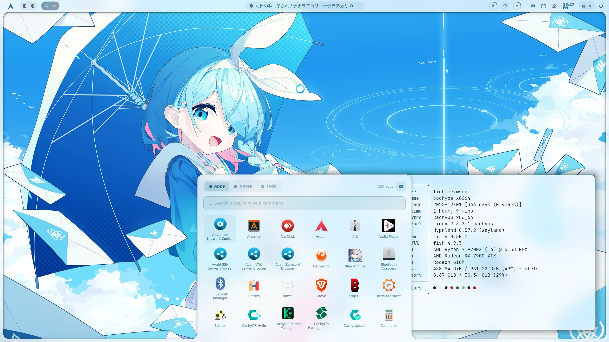</td>
  </tr>
  <tr>
    <td align="center">Media popup</td>
    <td align="center">Dock: apps, notes and to-dos</td>
  </tr>
  <tr>
    <td>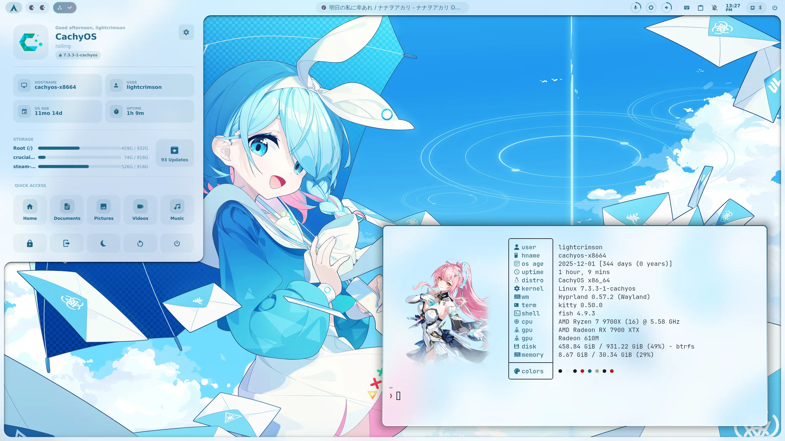</td>
    <td>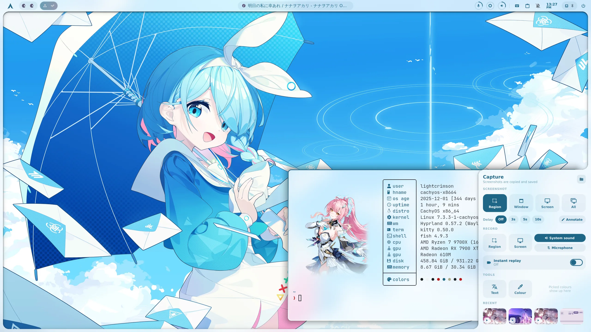</td>
  </tr>
  <tr>
    <td align="center">Dashboard</td>
    <td align="center">Capture drawer</td>
  </tr>
  <tr>
    <td>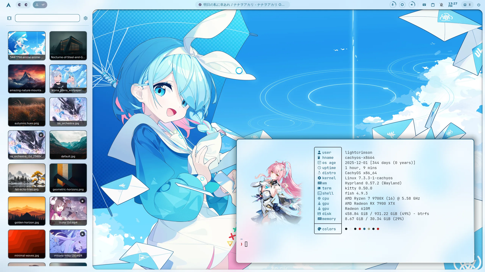</td>
    <td>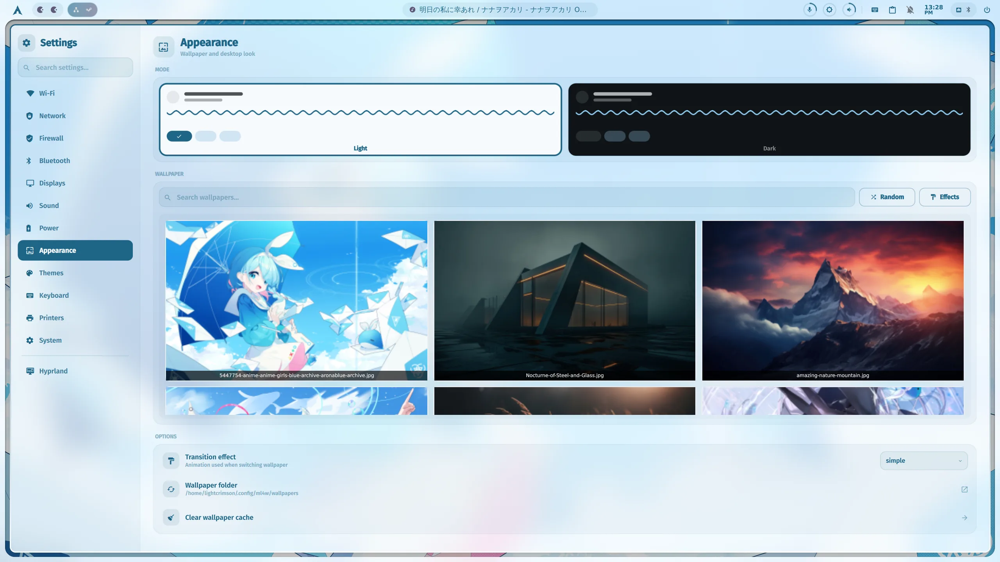</td>
  </tr>
  <tr>
    <td align="center">Wallpaper selector with video wallpapers</td>
    <td align="center">Settings app</td>
  </tr>
</table>

## Themes 🎭
Switch with `dotswitch`, Settings > Themes or quick settings. `dotswitch save` and `dotswitch restore <theme>` snapshot a theme and roll it back.

| Theme | Description |
| --- | --- |
| **LightCrimson** (default) | ML4W with the custom Quickshell shell shown above |
| **BA Inspired** | A bright game-HUD look: white panels, sky-blue accents, slanted plates and counters, floating windows |
| **HyperBA** | A game-lobby desktop on top of BA Inspired, with colours that follow the wallpaper |

### HyperBA
A game-lobby desktop. A level card, workspace counters and grouped buttons sit on top, with shortcuts, a now-playing banner, an Overview card and a menu bar on the desktop. When a workspace has tiled windows, the lobby goes away and the top turns into a compact bar.

<table>
  <tr>
    <td>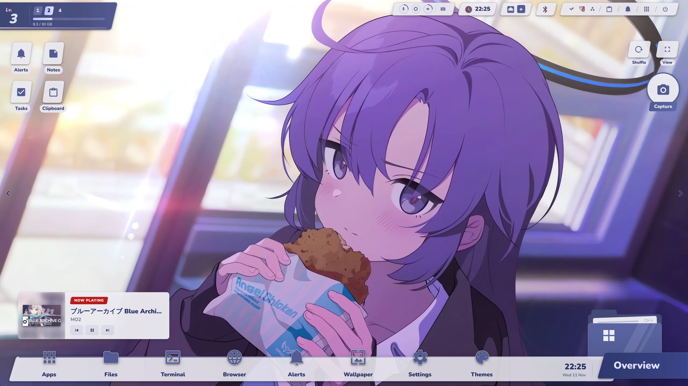</td>
    <td>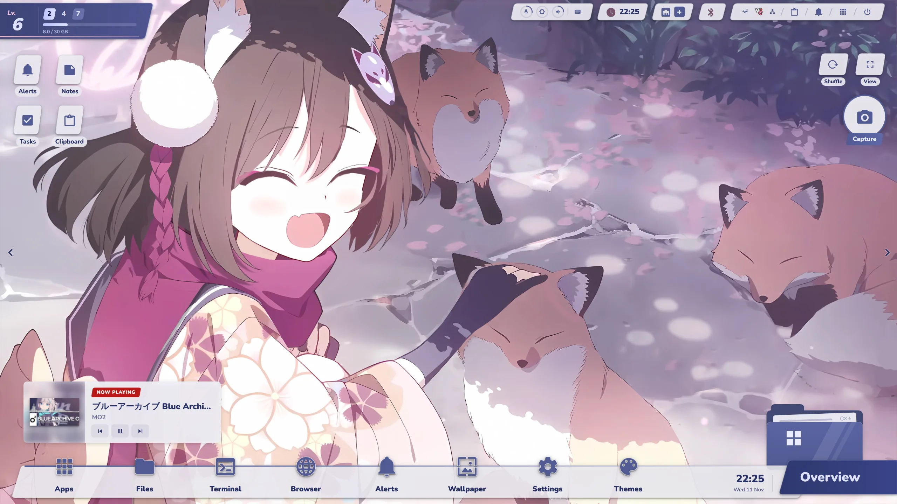</td>
  </tr>
  <tr>
    <td>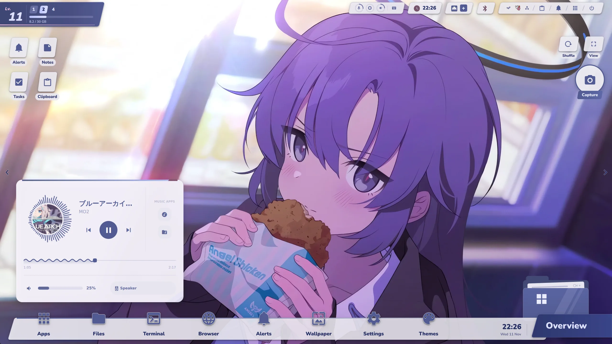</td>
    <td>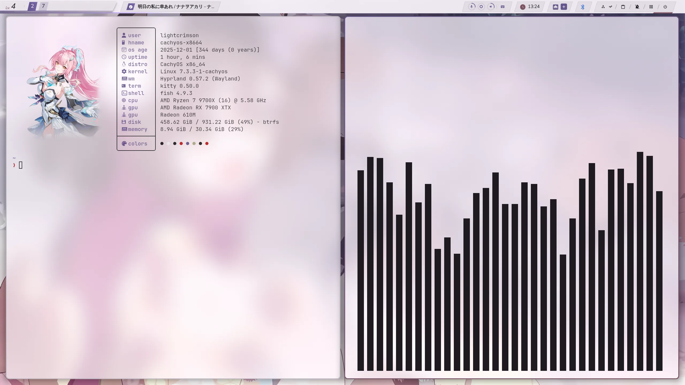</td>
  </tr>
  <tr>
    <td>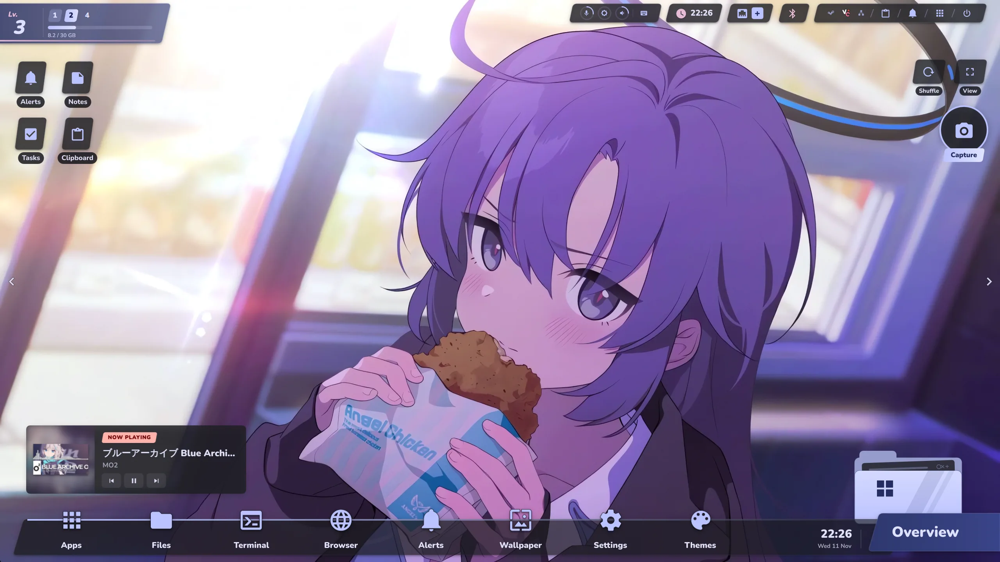</td>
    <td></td>
  </tr>
</table>

> [!NOTE]
> HyperBA and BA Inspired are fan-made themes inspired by the look of *Blue Archive*. They don't include any Blue Archive assets: everything is drawn in QML with generic icons and labels, without game art, logos, fonts or music. The live (Live2D) wallpapers in these screenshots are not included either. Add your own to `~/.config/ml4w/wallpapers` and pick them with the wallpaper selector, or per workspace with `META+SHIFT+E`. *Blue Archive* belongs to NEXON Games and Yostar, and the fan-art wallpapers in this repository belong to their artists.

## Keybindings ⌨️
These are the bindings this setup adds or changes; ML4W's own bindings are listed with `META+CTRL+K`.

| Keys | Action |
| --- | --- |
| `META+D` | Application launcher |
| `META+M` / `META+C` / `META+N` / `META+I` | Media / calendar / system / dashboard popups |
| `META+A` | Dock (apps, notes, to-dos) |
| `META+SHIFT+V` | Clipboard history |
| `META+SHIFT+K` | Keyboard layout |
| `META+X` | Power menu |
| `META+ALT+Q` | Quick settings |
| `PRINT` / `SHIFT+PRINT` / `CTRL+PRINT` | Capture drawer / region screenshot / start or stop recording |
| `META+P` | Colour picker |
| `META+SHIFT+I` | Settings |
| `META+SHIFT+E` | Per-workspace wallpapers |
| `META+W` / `META+CTRL+W` | Wallpaper carousel / selector |
| `META+SHIFT+M` | Light / dark mode |
| `META+ALT+G` | Game mode |
| `META+R` | Radial menu |
| `META+ALT+M` | Display manager |
| `META+Tab` | Window overview |
| `META+CTRL+C` | Calculator |

## Installation 🔧
Clone this repository and run the installer. Run it again later to update.

```bash
git clone https://github.com/yurihikari/ml4w-lightcrimson-dotfiles.git
cd ml4w-lightcrimson-dotfiles
bash install.sh
```

The installer:
1. installs the packages this setup needs on top of ML4W (see below)
2. installs or updates ML4W's dotfiles with the official ML4W installer, which installs ML4W's own dependencies
3. applies these dotfiles on top, installs the window overview, and hands notifications to Quickshell (SwayNC's service is masked)
4. installs `dotswitch` and the extra themes; LightCrimson stays active

## Dependencies 📦
`install.sh` installs these on top of ML4W's own dependencies. It uses the official repositories where it can and the AUR through `paru` or `yay` otherwise (`mpvpaper` is AUR-only on plain Arch).

| Package | Used for |
| --- | --- |
| `rsync`, `gum` | applying the dotfiles, `dotswitch` |
| `cava` | the media popup's visualizer |
| `zoxide` | directory jumping in the shell |
| `socat` | per-workspace wallpapers |
| `ffmpeg`, `mpvpaper` | video wallpapers |
| `gpu-screen-recorder` | screen recording and instant replay |
| `qt6-5compat` | Quickshell effects |
| `wireplumber`, `libpulse` | volume, microphone and audio outputs |
| `networkmanager` | Wi-Fi, VPN and network settings |
| `bluez`, `bluez-utils` | Bluetooth |
| `gnome-keyring` | secrets and SSH keys |
| `pciutils` | the GPU name in Settings |
| `xdg-utils` | opening files and folders |
| `zenity` | the file picker for VPN imports |
| `nemo` | the file manager |
| `adw-gtk-theme` | GTK 3 apps in the wallpaper's colours |
| `qt6ct`, `breeze` | Qt and KDE apps in the wallpaper's colours |
| `inotify-tools` | light / dark set in a GTK settings tool (nwg-look) applies to the whole desktop |

Optional, used when installed: `pear-desktop` (the media popup's music app button), `ufw` (Settings > Firewall), `cups` and `system-config-printer` (Settings > Printers), `nvidia-utils` (NVIDIA GPU stats).

## Special Thanks 🙏
Big thanks to [ML4W](https://github.com/mylinuxforwork/dotfiles) for making this setup so easy to build on, and to [Quickshell](https://quickshell.outfoxxed.me/).
